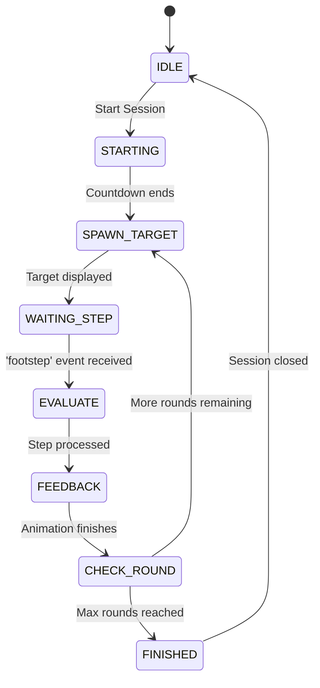

# MOVA - Architecture & Development Guide

This document defines the technical foundation for **MOVA**, the gamified software layer of the **PassoCerto** motor-rehabilitation project.

## 1. Product Vision

MOVA is designed to feel like a **real videogame**, avoiding the clinical "medical dashboard" aesthetic.

**Key principles:**
- **Patient TV Experience:** Colorful, playful, welcoming, and accessible. It uses a visual language inspired by classic family-friendly Nintendo-style games (white, red, orange backgrounds with yellow/green/blue accents, rounded shapes, and large UI elements). It focuses solely on the game logic, animations, and simple visual feedback.
- **Therapist Panel:** A clean, professional, but visually coherent interface that displays live protocol data, reaction times, session controls, and patient evolution.
- **Independence:** The TV and Therapist apps must be kept entirely separate from each other visually and logically, communicating only via shared state/events.

## 2. Architecture

The system operates strictly as a **Cyber-Physical System** with a clear separation of concerns. The physical mat (ESP32) is the single source of truth for step events.

```text
MOVA/
├── apps/
│   ├── tv/               # Patient-facing game interface
│   └── therapist-panel/  # Therapist dashboard and session controls
├── engine/               # Core event routing, game loop, and hardware abstraction
├── games/                # Individual game logic (e.g., estoura-baloes)
├── hardware/             # Interfaces for real ESP32 connections (WebSocket, etc.)
├── simulator/            # Mock hardware generator for local development
├── shared/               # Shared types, constants, and event definitions
├── assets/               # Shared imagery, sounds, and global styles
├── firmware/             # Future ESP32 C++ code
├── docs/                 # Documentation
└── tests/                # Unit and integration tests
```

**Core Rules:**
1. Hardware abstraction must exist. The engine does not care if an event comes from `simulator` or `hardware`.
2. The system must work **100% locally** (no cloud dependencies).
3. The UI (TV) is just a dumb renderer; all evaluation happens in the game logic/engine.

## 3. Technology Decisions

**Recommendation: Option C - HTML + CSS + Vanilla JS + DOM/CSS Animations (via Vite)**

**Reasoning:**
- **Simplicity:** A framework like Phaser (Option B) is incredibly powerful but introduces a steep learning curve and heavy dependencies. For an academic project focused on a simple first game ("Estoura-balões"), standard DOM manipulation coupled with CSS Transitions/Animations is more than enough to create a highly polished, responsive 2D UI.
- **Canvas (Option A):** While Canvas is great for drawing, managing UI (buttons, accessibility, text) inside Canvas is painful. DOM elements are naturally accessible (a core project requirement).
- **Tooling:** Using Vite as a bundler provides instant hot-module replacement (HMR), easy ES module support, and local network serving (so the therapist panel can be viewed on a tablet on the same Wi-Fi while the TV app runs on a PC).
- **WebSocket:** Native browser `WebSocket` APIs will be used for communication between the hardware/simulator and the engine.

## 4. Minimum Event Protocol

Communication between the Hardware (or Simulator) and the Engine is strictly standardized via JSON messages.

**Hardware -> Engine (Step Event)**
```json
{
  "type": "footstep",
  "zone": "center",       // ENUM: "center" | "front" | "right" | "back" | "left"
  "intensity": 0.72,      // Float: 0.0 to 1.0
  "timestamp": 16958432   // Integer: ms since boot or epoch
}
```

**Engine -> Hardware (Optional config/state)**
```json
{
  "type": "game_state",
  "state": "playing"      // ENUM: "idle" | "playing" | "paused"
}
```

## 5. Simulator Strategy

Because the ESP32 hardware is not currently available, a software simulator is critical.

The simulator will be a lightweight web interface containing a visual map of the mat:
```text
        [ FRONT ]
[ LEFT ][ CENTER ][ RIGHT ]
        [ BACK  ]
```
- **Interaction:** Clicking a zone generates a `footstep` event payload and dispatches it over the same WebSocket channel the real ESP32 would use.
- **Features:** It will allow developers to manually trigger correct or incorrect steps, adjust simulated intensity, and easily test edge cases without physical hardware.

## 6. First Game State Machine: ESTOURA-BALÕES

The game logic resides entirely separate from the TV UI. The UI just renders the current state.



- **EVALUATE State:** Calculates reaction time (`event.timestamp` - `target_spawn_time`), checks if `event.zone == expected_zone`, calculates score, and logs the result.

## 7. Development Milestones

1. **Milestone 1: The Simulator & Event Bus**
   - Build the basic Simulator UI.
   - Establish the event router (Engine) that listens to Simulator events.
2. **Milestone 2: First Game Logic**
   - Implement the `ESTOURA-BALÕES` state machine.
   - Feed simulator events into the game logic and print results to the console.
3. **Milestone 3: Patient TV Rendering**
   - Connect the game logic to the TV app UI.
   - Display a balloon, wait for step, show pop animation, and update score.
4. **Milestone 4: Therapist Panel**
   - Connect the therapist dashboard to read live session data and trigger the start/stop events.
5. **Milestone 5: Real Hardware Integration**
   - Swap the Simulator out for the physical ESP32 without changing any game code.
